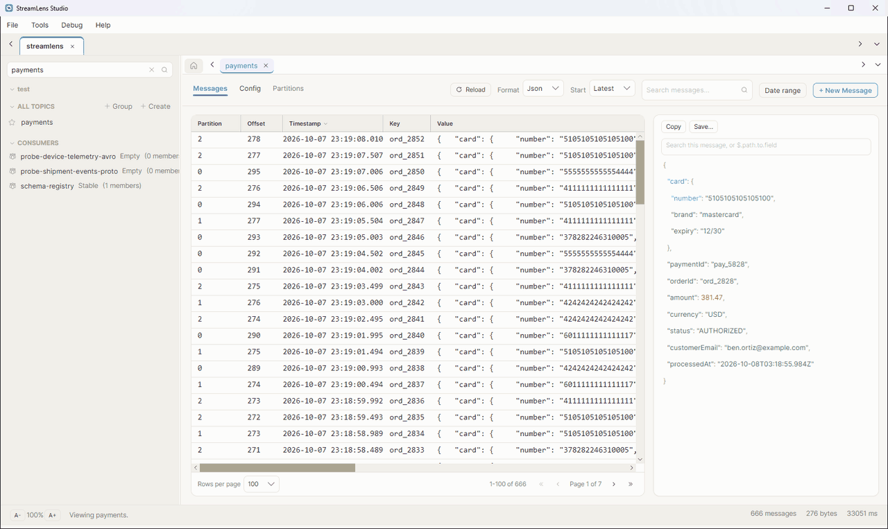
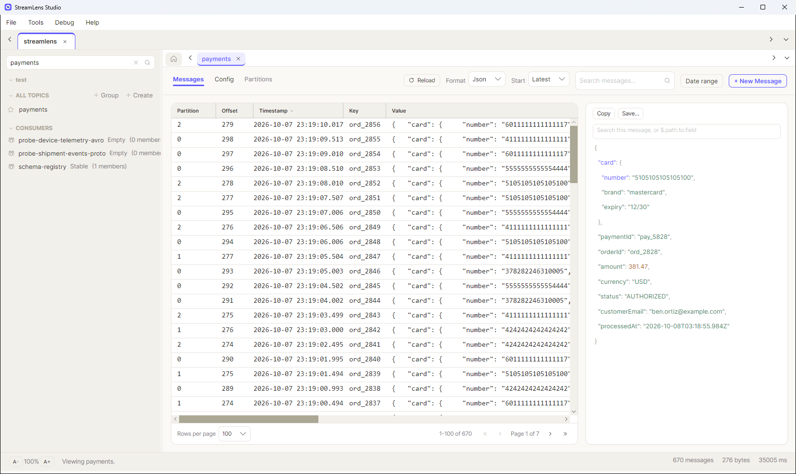
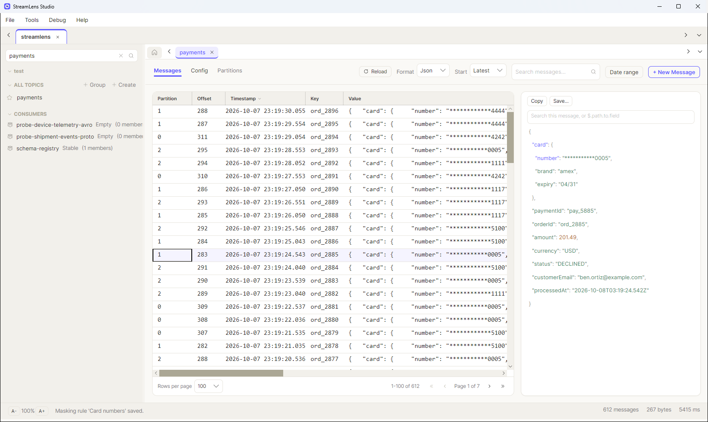
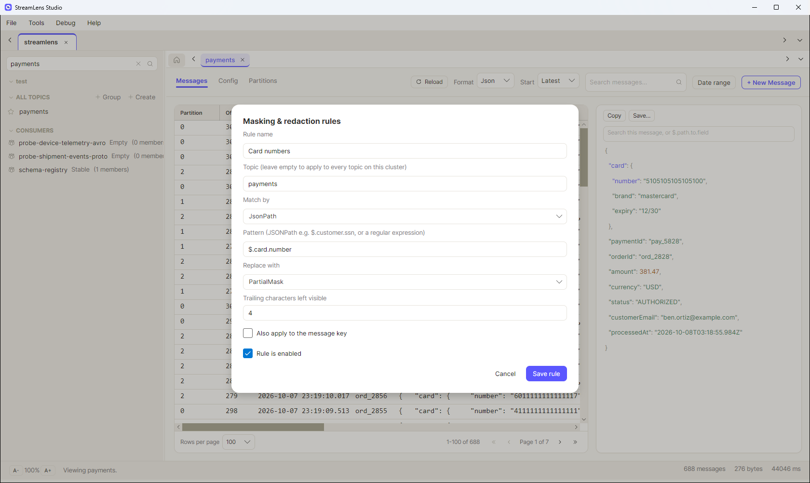
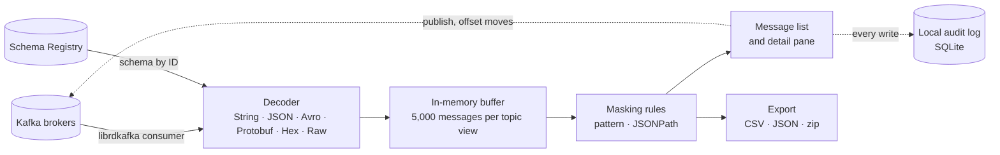

# StreamLens Studio: Free Kafka Desktop Client and GUI

**A native Apache Kafka GUI for Windows.** Browse topics, live-tail and decode
messages, search a whole topic, and mask sensitive fields without deploying a
web UI.

[](https://github.com/getaxtools/StreamLens/stargazers)
[](#license)
[](https://github.com/getaxtools/StreamLens/releases)
[](https://github.com/getaxtools/StreamLens/releases)
[](#quickstart)
[](#macos-and-linux)

StreamLens Studio is a free Kafka desktop client that lets you tail, decode,
search, and export Kafka messages from a single `.exe`, with no server to host
and no seat license to buy. Avro and Protobuf messages decode through your
Confluent Schema Registry, and masking rules keep card numbers and other PII
off your screen and out of every export.

<!-- Demo: keep this GIF under ~10 MB so it autoplays on GitHub. Replace
     docs/images/hero.gif to update it. -->


*Live tail of a `payments` topic. Saving a masking rule on `$.card.number`
cuts every card number on screen down to its last four digits, in the message
list and the detail pane.*

▶️ **[Watch the overview video](docs/videos/streamLens-Marketing.mp4)** (MP4, 8.7 MB)

> **Status: v0.8.0, pre-release.** Stable: cluster connections, topic browsing
> and live tail, decoding, search, publishing, masking, export, the audit log,
> diagnostics, bug reports and update checks. Not yet stable: the consumer
> groups view, including lag and offset moves. Windows only for now: Linux is
> expected in the first week of November 2026 and macOS in the first week of
> December 2026. We're also preparing to open-source StreamLens under GPL-3.0,
> so stay tuned for updates. There are real gaps, so read
> [Current limitations](#current-limitations) before you download.

**Contents:** [Quickstart](#quickstart) ·
[Key features](#key-features) ·
[How it works](#how-it-works) ·
[How it compares](#how-it-compares) ·
[Current limitations](#current-limitations) ·
[Roadmap](#roadmap) ·
[Where your data lives](#where-your-data-lives) ·
[Documentation](#documentation)

---

## Quickstart

### Windows

[**Download StreamLens.exe**](https://github.com/getaxtools/StreamLens/releases/latest/download/StreamLens.exe).
It's a single self-contained file, about 75 MB. No installer, no .NET
runtime, no account, nothing to configure.

Or from PowerShell:

```powershell
# Download the latest release
Invoke-WebRequest -Uri https://github.com/getaxtools/StreamLens/releases/latest/download/StreamLens.exe -OutFile StreamLens.exe

# Compare this hash with the SHA-256 published in the release notes
Get-FileHash .\StreamLens.exe -Algorithm SHA256

# Run it
.\StreamLens.exe
```

Then open **File → Add Connection…**, enter your bootstrap servers, and
connect. The [user guide](docs/usage_guide.md) walks you through connecting
to a cluster and reading your first messages.

> Windows shows a SmartScreen warning on first run. The build is signed, but
> with a self-signed certificate rather than one from a certificate authority,
> so Windows has no way to vouch for it. Choose **More info → Run anyway** if
> you're happy to proceed. The SHA-256 hash is what confirms your download is
> the file that was published. There's a walkthrough in
> [Verifying your download](docs/verification/README.md).

### Try it against a local Kafka cluster (Docker)

No cluster to hand? The repository includes a disposable Kafka stack with a
Schema Registry and 13 seeded topics: JSON order, payment, and clickstream
events, plus Avro and Protobuf topics that decode through the registry.

```bash
git clone https://github.com/getaxtools/StreamLens.git
cd StreamLens/docker
docker compose up -d
docker compose logs -f seed   # wait for it to exit 0
```

Then add a connection in StreamLens with:

| Field | Value |
|---|---|
| Bootstrap servers | `localhost:9092` |
| Security protocol | `Plaintext` |
| Schema Registry URL | `http://localhost:8081` |
| Environment | `Local` |

TLS/SASL and Kerberos variants are in the [local Kafka sandbox](docker/README.md)
guide. Tear down with `docker compose down -v`.

### macOS and Linux

There's no macOS or Linux download yet, and no Homebrew formula or Linux
package. The Linux build is expected in the first week of November 2026 and
the macOS build in the first week of December 2026. Both will go on the
[Releases page](https://github.com/getaxtools/StreamLens/releases). Watch the
repository (**Watch → Custom → Releases**) to hear when they land.

---

## Key features

- **Kafka live tail across all partitions.** New messages stream in as they
  arrive, from the latest offset or replayed from the earliest, with a topic
  filter, favorites, and colour-coded groups.
- **Schema Registry decoding for Avro and Protobuf.** Messages decode against
  the schema your Confluent Schema Registry holds, with String, pretty-printed
  JSON, Hex, and Raw views as well. Authenticated registries are supported.
- **Kafka data masking and PII redaction.** Pattern and JSONPath rules (for
  example `$.customer.ssn`) redact values in the message list, the detail
  pane, and every export. If a rule can't be applied, the value is withheld
  rather than shown.
- **Search a whole Kafka topic.** Find messages by text, by JSON field path
  (`$.order.id`), or by timestamp range, scanned on the broker rather than
  just in what's loaded.
- **Produce test messages.** Compose a message with key, value, headers, and
  target partition, or edit and republish an existing one. JSON is checked
  against the topic's registered Avro schema before it's sent. Values are sent
  as plain text (see [limitations](#current-limitations)).
- **Export Kafka messages to CSV, JSON, or zip,** with masking applied and
  spreadsheet formula injection escaped.
- **Production guardrails.** Tag a cluster `Production` and destructive
  actions make you type the resource name to confirm.
- **A local audit log.** Topic creates and deletes, offset moves, published
  messages, and connection changes are recorded, and **Tools → Audit Log…**
  filters and exports them.
- **Consumer group lag and offset reset** *(not yet stable)*. See per-partition
  lag and move a group to the start, the end, or a timestamp.
- **Secure cluster connections.** SASL (including SCRAM), SSL, mutual TLS, a
  private CA, and Kerberos (GSSAPI, configurable but not yet verified).
  Multiple saved clusters, with import and export that leaves passwords out.
  Saved passwords are encrypted with Windows DPAPI.
- **Per-topic settings that persist.** Format and start position are
  remembered per topic, so reopening one doesn't quietly reset it to raw bytes
  and start-from-beginning.
- **Diagnostics you can read.** An Output panel shows each connection step
  with timings, so a slow step doesn't look like a hang. Crashes and failed
  connections produce a report you preview before filing it as a GitHub issue.

### Masking in action

Most Kafka UIs are web apps you have to deploy and maintain, and the desktop
alternatives tend to be licensed per seat or built on aging Java toolkits.
Masking is where StreamLens differs most from other free desktop clients.

<table>
  <tr>
    <th>Without a rule</th>
    <th>With a rule on <code>$.card.number</code></th>
  </tr>
  <tr>
    <td></td>
    <td></td>
  </tr>
</table>

<details>
<summary>The rule behind it</summary>

A JsonPath rule scoped to the `payments` topic, replacing the value with a
partial mask that leaves the last four characters visible.
See [Masking and redaction](docs/masking-and-redaction.md) for every option.


</details>

A rule that fails to compile is skipped with a warning, so check the status
bar after saving one. Treat masking as display and export hygiene rather than
a security boundary, because the full message still comes from the broker.
What it does do is keep card numbers off a screen you're sharing.

---

## How it works

StreamLens is a self-contained .NET desktop app. There's no backend service,
agent, or proxy: it talks to your brokers and Schema Registry directly, the
same way any Kafka client does.



- **Kafka client.** Connections, consuming, producing, and admin calls go
  through [Confluent.Kafka](https://github.com/confluentinc/confluent-kafka-dotnet),
  the .NET binding for [librdkafka](https://github.com/confluentinc/librdkafka).
  Security settings map onto librdkafka's, which is why Kerberos on Windows
  uses SSPI and your logged-on account.
- **Decoding.** Avro and Protobuf values are read in Confluent wire format (a
  magic byte, then a 4-byte schema ID). StreamLens fetches that schema from
  the registry and decodes with Apache Avro or the registry's `.proto`, so
  field names, enums, and nested messages come out as real JSON that
  field-path search and masking can work on. A value that can't be decoded
  shows `[decode error: …]` plus the raw hex, never a silent fallback.
- **Masking.** Rules run on the decoded value after it leaves the buffer and
  before it reaches any view or export. A pattern rule that times out
  withholds the value.
- **Storage.** Messages are held in memory only and never written to disk.
  Connections, settings, per-topic preferences, masking rules, and the audit
  log live in a local SQLite database. Passwords and key passphrases are
  encrypted with Windows DPAPI and kept out of that database.
- **UI.** Built with [Avalonia](https://avaloniaui.net/), a cross-platform UI
  toolkit, which is what makes the macOS and Linux builds a packaging and
  secret-store job rather than a rewrite.

The full list of bundled components and their licenses is in
[THIRD-PARTY-NOTICES.md](THIRD-PARTY-NOTICES.md).

---

## How it compares

Each of these tools has strengths. The web UIs cover more of Kafka's admin
surface, and StreamLens is the only one here that's both free for commercial
use and needs nothing deployed. The table shows where StreamLens is behind as
well as where it's ahead.

✅ Yes  ·  🟡 Partly  ·  ❌ No  ·  ❔ Not documented

| | StreamLens Studio | [Kafka UI (Kafbat)](https://github.com/kafbat/kafka-ui) | [AKHQ](https://github.com/tchiotludo/akhq) | [Offset Explorer](https://www.kafkatool.com/) |
|---|---|---|---|---|
| **Getting started** | | | | |
| Free for commercial use | ✅ | ✅ | ✅ | ❌ Paid after a 30-day trial |
| Open source | 🟡 Planned, GPL-3.0 | ✅ Apache-2.0 | ✅ Apache-2.0 | ❌ Proprietary |
| Desktop app, nothing to deploy | ✅ | ❌ Server you host | ❌ Server you host | ✅ |
| Platforms | 🟡 Windows; Linux and macOS coming | ✅ Any browser | ✅ Any browser | ✅ Windows, macOS, Linux |
| **Connecting** | | | | |
| Multiple clusters | ✅ | ✅ | ✅ | ✅ |
| SASL, SSL and mutual TLS | ✅ | ✅ | ✅ | ✅ |
| Kerberos (GSSAPI) | 🟡 Configurable, not verified | ✅ | ❔ | ❔ |
| **Reading messages** | | | | |
| Live tail | ✅ | ✅ | ✅ | ❔ |
| JSON, pretty-printed | ✅ | ✅ | ✅ | ✅ |
| Avro via Schema Registry | ✅ | ✅ | ✅ | ✅ |
| Protobuf via Schema Registry | ✅ | ✅ | ✅ | ✅ |
| Protobuf without a registry | ❌ | ✅ `.proto` files | 🟡 Compiled descriptors | ❔ |
| Search the whole topic by field and time | ✅ | ✅ | 🟡 Text match only | ✅ |
| **Writing messages** | | | | |
| Produce messages | ✅ | ✅ | ✅ | ✅ |
| Produce Avro or Protobuf with registry framing | ❌ Sends plain text | ✅ | ✅ | ✅ |
| **Protecting data** | | | | |
| Field masking | ✅ Pattern and JSONPath | ✅ Remove, replace, mask | ✅ Regex and JSON fields | ❔ |
| Audit log | ✅ Local, with a viewer | ✅ Kafka topic or console | ✅ Kafka topic | ❔ |
| Production guardrails | ✅ Type the name to confirm | ✅ Read-only mode | ✅ Read-only role | ❔ |
| Export messages | ✅ CSV, JSON, zip | ✅ CSV, JSON | 🟡 JSON only | 🟡 Raw binary |
| **Operating the cluster** | | | | |
| Consumer groups with lag | 🟡 Not yet stable | ✅ | ✅ | ✅ |
| Reset offsets to earliest, latest or a time | 🟡 One topic at a time, not yet stable | ✅ | ✅ | 🟡 Specific offsets only |
| Kafka Connect | ❌ | ✅ | ✅ | ✅ |
| ksqlDB | ❌ | ✅ | ✅ | ✅ |
| ACL management | ❌ | ✅ | 🟡 View only | ✅ |
| Logins and roles for teams | ❌ Single user | ✅ | ✅ | ❔ |

Checked against each project's own docs and source in October 2026.
❔ means we couldn't find it documented, not that it's missing. Spot something
wrong? Please [open an issue](https://github.com/getaxtools/StreamLens/issues).
Conduktor Desktop isn't listed because it has reached end of life, and
existing installs can no longer sign in. Conduktor now offers the web-based
Conduktor Console instead.

### Compared with command-line tools

[kcat](https://github.com/edenhill/kcat) and Kafka's own
`kafka-console-consumer` are the right tools for scripting and pipelines, and
StreamLens doesn't try to replace them. Where a GUI helps is the interactive
part of debugging: scrolling back through what just arrived, opening one
message as formatted JSON, searching by field, and sharing your screen with
PII masked. Neither CLI masks fields, and neither keeps per-topic settings or
an audit log of what you changed.

---

## Current limitations

Being upfront so you don't waste a download:

- **Windows only for now.** The Linux build is expected in the first week of
  November 2026, and the macOS build in the first week of December 2026. See
  the [roadmap](#roadmap).
- **No Kafka Connect, ksqlDB, or ACL management.**
- **Publishing doesn't encode Avro or Protobuf.** The app sends the value as
  plain UTF-8 text, without the Confluent framing (magic byte and schema ID).
  Anything you publish to an Avro or Protobuf topic can't be read by consumers
  that use the registered schema, so use your own producer for those topics.
- **Protobuf needs a Schema Registry.** A payload with no registered schema
  can't be decoded, since there's no schemaless fallback.
- **Offsets move one topic at a time**, and only while the group has no
  running members. Kafka refuses it otherwise, so the app refuses first.
- **Kerberos (GSSAPI) is configurable but not verified end to end.** The
  broker setup has been tested against a test KDC with a Linux Kafka client.
  On Windows the app uses SSPI, which needs a domain-joined machine and an
  Active Directory service principal, and we haven't tested that. Keytabs
  don't work on Windows at all, since the underlying client uses your
  logged-on account. Kerberos on macOS and Linux will be tested when those
  builds ship.
- **Single user.** No logins or roles of its own, so your operating-system
  account is the access boundary.

## Roadmap

The roadmap isn't fixed, and what people report shapes the order things get
built in. Most-wanted first:

- **Linux and macOS builds.** Linux is expected in the first week of November
  2026, and macOS in the first week of December 2026. The UI toolkit is
  cross-platform already, so the work is in the platform-specific pieces,
  mainly the secret store and packaging.
- **Protobuf from a local `.proto` file**, for topics with no Schema Registry.
  Registry-backed decoding works today.
- **Verifying Kerberos on Windows** against a domain-joined machine and a real
  Active Directory service principal.
- **Moving offsets for more than one topic at a time**, the next step now
  that the per-topic case is in.

Think the order is wrong, or want something that isn't listed? Make the case
in an [issue](https://github.com/getaxtools/StreamLens/issues) or in
[Discussions](https://github.com/getaxtools/StreamLens/discussions). At this
stage a single well-argued request can change the order.

## Where your data lives

Everything is local. No account, no cloud service, no telemetry.

The one exception is the update check. Once a day StreamLens asks GitHub what
the latest released version is. It sends nothing about you, your machine, or
your clusters, and it does nothing at all when you're offline. There's more
detail in
[Keeping StreamLens up to date](docs/usage_guide.md#11-keeping-streamlens-up-to-date).

```
%LocalAppData%\StreamLensStudio\
  streamlens.db       # connections, settings, per-topic preferences, audit log
  secrets\            # your cluster passwords, encrypted by Windows
  diagnostic.log      # local troubleshooting log
  crashes\            # crash reports, if the app has ever hit one
  update-check.json   # when updates were last checked for, and any version you dismissed
  window-layout.json  # window chrome that survives a restart, such as the sidebar width
```

Once they ship, the macOS and Linux builds will keep the same files in
`~/Library/Application Support/StreamLensStudio/` and
`~/.local/share/StreamLensStudio/`. The macOS build will keep cluster
passwords in the Keychain instead of `secrets/`.

Kafka messages are **never** written to disk. They stream from the broker and
are held in memory only, capped at 5,000 messages per topic view.

`diagnostic.log` is plain text, and it records previews of message content
along with the addresses of clusters you connect to (never passwords). Read
[Your data and security](docs/usage_guide.md#9-your-data-and-security) before
you attach it to a bug report. The same goes for a crash report, which is why
the app shows you one in full before it goes anywhere.

## Community and support

- **Bugs:** open a [GitHub issue](https://github.com/getaxtools/StreamLens/issues).
  Include what you were doing, what you expected, and what actually happened,
  plus the StreamLens version and your OS. If it's a connection problem, your
  Kafka setup helps too: managed service or self-hosted, and which security
  protocol.
- **Questions and ideas:** use
  [GitHub Discussions](https://github.com/getaxtools/StreamLens/discussions).
- **From inside the app:** after a crash or a failed connection, the
  **Report this** button does most of the work. It shows you the full report,
  puts it on your clipboard, and opens a pre-filled issue. Nothing leaves your
  machine until you've read it and chosen to send it.

If StreamLens saves you time, a ⭐ on the repository helps other Kafka
developers find it.

## Documentation

The full index is in [docs/](docs/README.md).

**Using the app**

- [User guide](docs/usage_guide.md) covers connecting, reading messages,
  searching, publishing, exporting, and what the app stores on your machine
- [Masking and redaction](docs/masking-and-redaction.md) explains
  how to write and test redaction rules
- [Verifying your download](docs/verification/README.md) walks through
  checking the SHA-256 hash, and what the code signature does and doesn't
  prove

**Trying it against a local Kafka**

- [Local Kafka sandbox](docker/README.md) starts a disposable cluster with
  seeded topics: plaintext, TLS/SASL, and Kerberos stacks
- [Testing connection types](docs/testing-connections.md) has step-by-step
  setup for plaintext, mutual TLS, SASL/SCRAM, and an authenticated Schema
  Registry
- [Testing Avro](docs/testing/avro.md) covers schema evolution, logical types,
  and malformed payloads

## License

StreamLens Studio is free to use, including commercially, on as many machines
as you like. No seat limits, no registration, no trial period. Full terms are
in [LICENSE](LICENSE).

We're preparing to release the source code under the GNU General Public
License v3.0. Stay tuned for updates: watch this repository or check the
[Releases page](https://github.com/getaxtools/StreamLens/releases).

StreamLens Studio bundles third-party open-source components, and their
licenses are reproduced in [THIRD-PARTY-NOTICES.md](THIRD-PARTY-NOTICES.md).
